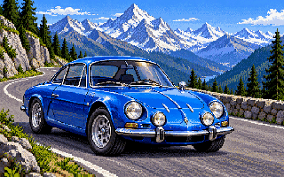

# 06 — Alpine A110 Berlinette

Custom car for Stunts / 4D Sports Driving by **Alain il Professore · Hyperion Racing Team**.

[Download the complete pack](ALPINE_A110_FINAL_PACK.zip) · [English instructions](README_EN.md) · [Instructions en français](README_FR.md) · [Changelog EN](CHANGELOG_EN.md) · [Changelog FR](CHANGELOG_FR.md)

## Install and restore

Extract the ZIP. Place **ALP_A110** directly inside your Stunts game directory, close the game and run **INSTALL.BAT** from ALP_A110. Run **UNINST.BAT** from that same folder to restore previous resources. Keep ALP_A110 and its backup in place while installed. In DOSBox, mount the game folder, then type `CD ALP_A110` followed by `INSTALL` or `UNINST`.

The archive contains CARA110.RES, STA110.3SH, STDAA110.VSH and STDBA110.VSH, plus scripts and bilingual documentation. It is published byte for byte from the supplied ALPINE_A110_FINAL_PACK(1).zip.

## Artwork

[Download VGA bitmap](cover.bmp) · [PNG preview](cover.png). Both files are indexed 320 × 200 images with a 256-entry palette aligned to VGA six-bit channel values.

Generated with the built-in image generator. Prompt: blue classic 1970 Renault Alpine A110 1600 S Berlinette, four round front lamps, three-quarter front view on a winding Alpine pass, snowy peaks and conifers, DOS VGA bitmap pixel art, 8:5 composition, without text. Converted to native 320 × 200 indexed PNG/BMP.

## Integrity

Archive SHA-256: `e527d68b1745cbb475c52cce0c559c6d5fe02c60b54ed4c25f389a0fa6c483a7`. ZIP CRC passed. The supplied internal manifest predates the latest CARA110.RES: ten listed hashes match, while that resource now hashes to `be2d4f814b1630a199659bf7e89fd8fac3c379d30814170453ba0fae545d8304`. The supplied archive is preserved unchanged; [PAYLOAD_SHA256SUMS.txt](PAYLOAD_SHA256SUMS.txt) records the actual hashes of every archived file. See the supplied README for the source pack's game-testing limitations.
