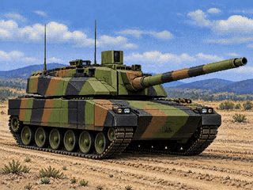

# 07 — AMX Leclerc V03

Stunts / 4D Sports Driving vehicle project by **Alain il Professore · Hyperion Racing Team**.

[Download AMX Leclerc V03](AMX_LECLERC_V03.zip) · [VGA bitmap](cover.bmp) · [PNG preview](cover.png) · [Project on the website](https://hyperionracingteamwin.github.io/stunts-data/#amx-leclerc)

## Installation — English

1. Close Stunts and back up any existing LECL resources outside the game folder.
2. Extract the ZIP and copy **CARLECL.RES**, **STLECL.3SH**, **STDALECL.VSH** and **STDBLECL.VSH** into your **Stunts 1.1 VGA** directory.
3. If present, move competing **STLECL.P3S**, **STDALECL.PVS** and **STDBLECL.PVS** outside that directory so the supplied shapes can be loaded.
4. Start your own copy of Stunts and select the Leclerc vehicle.

To restore: close the game, remove the four installed files and restore the LECL files you backed up, including any compressed variants. This supplied archive contains four native resources; installation is manual.

## Installation — Français

1. Fermez Stunts et sauvegardez les éventuels fichiers LECL existants hors du dossier du jeu.
2. Extrayez le ZIP, puis copiez **CARLECL.RES**, **STLECL.3SH**, **STDALECL.VSH** et **STDBLECL.VSH** dans le dossier de **Stunts 1.1 VGA**.
3. S'ils existent, déplacez **STLECL.P3S**, **STDALECL.PVS** et **STDBLECL.PVS** hors de ce dossier pour permettre le chargement des fichiers fournis.
4. Lancez votre copie de Stunts et sélectionnez le Leclerc.

Pour restaurer : fermez le jeu, retirez les quatre fichiers installés et remettez vos anciens fichiers LECL, y compris les éventuelles variantes compressées. L'archive fournie contient quatre ressources natives ; l'installation est manuelle.

## Archive contents

| File | Bytes | Resource |
| --- | ---: | --- |
| CARLECL.RES | 1076 | Vehicle resource |
| STLECL.3SH | 11182 | 3D shapes |
| STDALECL.VSH | 57294 | VGA cockpit resource A |
| STDBLECL.VSH | 1862 | VGA cockpit resource B |

The supplied **AMX LECLERC V03.zip** is published byte for byte as **AMX_LECLERC_V03.zip**. ZIP CRC validation passed. Game behavior has not been tested as part of this publication.

## Artwork

The website preview **cover.png** and downloadable **cover.bmp** use the same indexed **320 × 240** pixels and **256-entry palette**, with RGB values aligned to VGA six-bit channels. This is promotional artwork, not a game screenshot or an installed title screen.

Generated with the built-in image generator, then encoded for VGA-style display. Prompt: Camouflaged French Leclerc main battle tank, front three-quarter view with the complete gun and tracks in frame, dusty training ground and distant hills, early 1990s DOS VGA digitized-photograph style, clustered pixels and restrained 256-color palette, 4:3 composition, no people or text. Refined to show six large road wheels per side and the compact Leclerc silhouette.

## Integrity

Archive SHA-256: `e676eed47723fba73364c38cf873063c2268811031832fcc7ceb44ebe4c9873d`.

[Published file checksums](SHA256SUMS.txt) · [Checksums of the four files inside the ZIP](PAYLOAD_SHA256SUMS.txt).
