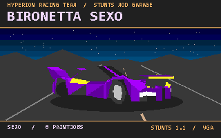

# 11 · BIRONETTA SEXO — SEXO

**Alain il Professore · Hyperion Racing Team** · Stunts 1.1 VGA

[Télécharger / Download](SEXO.zip) · [VGA BMP](cover.bmp) · [CHANGELOG](CHANGELOG.md) · [SHA-256](SHA256SUMS.txt)

Vignette pixel art indexée 320 × 200, palette 256 couleurs. La voiture reprend la géométrie `car0` et la première livrée. Le décor est illustré.

Indexed 320 × 200 pixel-art cover with a 256-entry palette. The car uses its `car0` geometry and first paintjob on an illustrated background.

## Français

Le concept Midnight Plug 69 Special avec six livrées, une boîte à cinq rapports et un cockpit numérique VGA. Nom dans Stunts · **Bironetta SEXO**.

1. Fermez Stunts. Décompressez tous les fichiers du ZIP dans `C:\STUNTS\SEXOPACK\`, juste sous le dossier de votre jeu. Adaptez `C:\STUNTS` à votre installation.
2. Sous Windows, lancez `INSTWIN.CMD`. Sous DOS ou DOSBox, placez-vous dans `SEXOPACK` et tapez `INSTDOS`.
3. Lancez Stunts 1.1 en VGA et sélectionnez **Bironetta SEXO**.
4. Pour désinstaller, fermez Stunts et lancez `UNWIN.CMD` ou `UNDDOS` depuis le même dossier. Gardez `BACKUP` jusqu’à la fin de la restauration.

Le script sauvegarde les anciens fichiers du code `SEXO` et écarte les variantes compressées concurrentes (`STSEXO.P3S`, `STDASEXO.PVS`, `STDBSEXO.PVS`). À la désinstallation, il retire les ressources du même code et remet celles sauvegardées. En cas d’installation interrompue après la sauvegarde, lancez le désinstallateur pour revenir à l’état précédent.

## English

The Midnight Plug 69 Special concept with six liveries, a five-speed gearbox and a digital VGA cockpit. In-game name · **Bironetta SEXO**.

1. Close Stunts. Extract the entire ZIP to `C:\STUNTS\SEXOPACK\`, one level inside your game folder. Substitute your own game path for `C:\STUNTS`.
2. On Windows, run `INSTWIN.CMD`. In DOS or DOSBox, change to `SEXOPACK` and type `INSTDOS`.
3. Start Stunts 1.1 in VGA mode and select **Bironetta SEXO**.
4. To uninstall, close Stunts and run `UNWIN.CMD` or `UNDDOS` from the same folder. Keep `BACKUP` until restoration finishes.

The installer backs up existing `SEXO` files and moves conflicting packed resources (`STSEXO.P3S`, `STDASEXO.PVS`, `STDBSEXO.PVS`) aside. Uninstall removes resources for this code and restores the saved copies. If installation stops after the backup, use the uninstaller to restore the previous state.

## Fichiers vérifiés / Verified files

| Fichier / File | Octets / Bytes | Ressources / Resources |
| --- | ---: | ---: |
| `CARSEXO.RES` | 1001 | 4 |
| `STSEXO.3SH` | 13353 | 7 |
| `STDASEXO.VSH` | 151790 | 15 |
| `STDBSEXO.VSH` | 7030 | 18 |

Les quatre binaires correspondent octet pour octet aux pièces jointes d’origine. `HASHES.TXT` contient leurs empreintes SHA-256. Les tailles, offsets et identifiants des conteneurs, les indices et matériaux du modèle, et les tailles des sprites et masques ont été contrôlés. Six livrées ont été chargées lors de courts essais d’accélération et de freinage avec le moteur de rejeu re-stunts. L’installation et la restauration ont été testées sous Windows et DOSBox 0.74-3, y compris les fichiers compressés concurrents. La conduite dans le jeu DOS d’origine reste à vérifier.

All four binaries match the original attachments byte for byte. Their SHA-256 checksums are in `HASHES.TXT`. The checks covered container lengths, offsets and identifiers, model indices and materials, and sprite and mask dimensions. Short acceleration and braking runs loaded all six liveries in the re-stunts replay engine. Installation and restoration were tested on Windows and DOSBox 0.74-3, including conflicting packed files. A driving test in the original DOS game remains pending.
