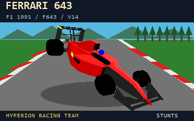

# Ferrari 643 F1 1991 — F643 · V14

By Alain il Professore — Hyperion Racing Team · 11 November 2026

[Download V14 ZIP](./FERRARI_643_F1_1991_V14.zip) · [DynoLab benchmark](../../homologation/reports/HRT_HOMOLOGATION_F643.html) · [Watch THE STUNG](https://youtu.be/r-lxtuEWlEw) · [Benchmark replay](../../homologation/replays/LF643001.RPL)

The supplied ZIP includes CARF643.RES, STF643.3SH, STDAF643.VSH and STDBF643.VSH, eleven paintjobs, Windows/DOS installation and restoration scripts, English/French/Russian documentation, development sources, audits and the original V13 resources.

V14 adjusts helmet sorting and prevents competing cockpit refresh rectangles from erasing the gear display. The source audit states that physics and gear ratios are byte-identical to V13. Native projection and cockpit compositions are static checks; the archive does not claim a new full V14 DOSBox playtest.

## Install and restore

Extract FERRARI_643_F1_1991_V14 as a subfolder of Stunts. Close the game. Run INSTALL_WIN.CMD on Windows or INSTALL.BAT from the package folder in DOS/DOSBox. Restore with REMOVE_WIN.CMD or REMOVE.BAT. Install all four resources together and retain backups.

## Benchmark and video

The supplied STUNTS DYNO LAB V4 report is dated 11 November 2026. It records seven completed protocols, zero missed targets and an autonomous Restunts lap of **105.55 s (1:45.55)** on TOPSTNT.TRK, referencing LF643001.RPL. Peak lap speed: 190.7 mph; average: 118.5 mph. The source replay is hosted separately, unchanged; this publication did not rerun the benchmark.

Estimated bench V-Max: 331.01 km/h (331.0 in the summary); estimated power: 1,468 ch. The source summary gives 0–100 km/h as **2.16 s**, while detailed protocol 04 gives **2.20 s**. Both remain unchanged. Bench model estimates and the autonomous lap are different methods; the YouTube video is linked without assigning it the autonomous benchmark time.

## Source integrity and thumbnail

The V14 pack was updated on 11 November 2026 to fix the last line of the in-game description. CARF643.RES now ends its edes text with `by Alain il Professore]` followed by the NUL terminator. The menu draws each line when it reaches `]`; the former missing final separator hid the author credit.

Only the description resource and container length changed in CARF643.RES. Its simd, gnam and gsna resources are byte-identical to the previously published pack, and all three graphics files are unchanged. The original benchmark remains applicable to the same simulation parameters.

The current ZIP contains 55 entries and 4,241,509 bytes. SHA-256: `675d5a93e9e828617b3dfd1b8779d6c501db70fae6fd36635aec9fff037ea5e6`. Updated CARF643.RES SHA-256: `63228354831ec09ec9c5ee8ce85dffd7e4a2f501b3b13cdd5692023b571170af`. All 54 internal manifest entries match, and the portable builder was rerun and reproduced all four shipped binaries. Original validation results are retained; the text-fix validation is in EDES_FIX_VALIDATION.json. No new full DOSBox playtest was performed.

Original source ZIP SHA-256 (before the text fix): `fb6550394cea48327bf7463dc2f1835c1bc7388190d329d12c4e3ff3682cfb72`. It had a stale CAR hash because its in-game description had already been expanded. The current audit and manifest record the corrected file.

The 320 × 200 PNG and BMP are indexed 8-bit images with a 256-entry palette. The car is rendered from the supplied, unchanged car0 geometry and paintjob 0 using the included native projection queue and Stressed palette/material tables. The circuit background is illustrative; this image is not a DOSBox screenshot.
