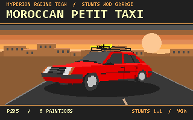

# 10 · MOROCCAN PETIT TAXI — P205

**Alain il Professore · Hyperion Racing Team** · Stunts 1.1 VGA

[Télécharger / Download](P205.zip) · [VGA BMP](cover.bmp) · [CHANGELOG](CHANGELOG.md) · [SHA-256](SHA256SUMS.txt)

Vignette pixel art indexée 320 × 200, palette 256 couleurs. La voiture reprend la géométrie `car0` et la première livrée. Le décor est illustré.

Indexed 320 × 200 pixel-art cover with a 256-entry palette. The car uses its `car0` geometry and first paintjob on an illustrated background.

## Français

Si la version 1.0.0 est déjà installée, désinstallez-la depuis son dossier avant d’installer cette version.

Petit taxi Peugeot 205 avec six livrées. Le jeu les présente dans l’ordre Casablanca, Fès, Tanger, Marrakech, Meknès et Agadir. Nom dans Stunts · **Moroccan Petit Taxi**.

1. Fermez Stunts. Décompressez tous les fichiers du ZIP dans `C:\STUNTS\P205PACK\`, juste sous le dossier de votre jeu. Adaptez `C:\STUNTS` à votre installation.
2. Sous Windows, lancez `INSTWIN.CMD`. Sous DOS ou DOSBox, placez-vous dans `P205PACK` et tapez `INSTDOS`.
3. Lancez Stunts 1.1 en VGA et sélectionnez **Moroccan Petit Taxi**.
4. Pour désinstaller, fermez Stunts et lancez `UNWIN.CMD` ou `UNDDOS` depuis le même dossier. Gardez `BACKUP` jusqu’à la fin de la restauration.

Le script sauvegarde les anciens fichiers du code `P205` et écarte les variantes compressées concurrentes (`STP205.P3S`, `STDAP205.PVS`, `STDBP205.PVS`). À la désinstallation, il retire les ressources du même code et remet celles sauvegardées. En cas d’installation interrompue après la sauvegarde, lancez le désinstallateur pour revenir à l’état précédent.

## English

If version 1.0.0 is already installed, uninstall it from its own folder before installing this version.

Peugeot 205 taxi with six Moroccan city liveries. The in-game order is Casablanca, Fès, Tanger, Marrakech, Meknès and Agadir. In-game name · **Moroccan Petit Taxi**.

1. Close Stunts. Extract the entire ZIP to `C:\STUNTS\P205PACK\`, one level inside your game folder. Substitute your own game path for `C:\STUNTS`.
2. On Windows, run `INSTWIN.CMD`. In DOS or DOSBox, change to `P205PACK` and type `INSTDOS`.
3. Start Stunts 1.1 in VGA mode and select **Moroccan Petit Taxi**.
4. To uninstall, close Stunts and run `UNWIN.CMD` or `UNDDOS` from the same folder. Keep `BACKUP` until restoration finishes.

The installer backs up existing `P205` files and moves conflicting packed resources (`STP205.P3S`, `STDAP205.PVS`, `STDBP205.PVS`) aside. Uninstall removes resources for this code and restores the saved copies. If installation stops after the backup, use the uninstaller to restore the previous state.

## Fichiers vérifiés / Verified files

| Fichier / File | Octets / Bytes | Ressources / Resources |
| --- | ---: | ---: |
| `CARP205.RES` | 982 | 4 |
| `STP205.3SH` | 13688 | 7 |
| `STDAP205.VSH` | 83222 | 15 |
| `STDBP205.VSH` | 1926 | 8 |

Les trois fichiers graphiques correspondent octet pour octet aux pièces jointes d’origine. La version 1.0.1 met à jour le nom et le titre de la description dans `CARP205.RES`. Les données de conduite et le code `P205` sont conservés. `HASHES.TXT` contient les empreintes SHA-256 de cette version. Le suffixe de téléchargement `(1)` a été retiré des quatre noms pour que le jeu reconnaisse les fichiers. Les tailles, offsets et identifiants des conteneurs, les indices et matériaux du modèle, et les tailles des sprites et masques ont été contrôlés. Six livrées ont été chargées lors de courts essais d’accélération et de freinage avec le moteur de rejeu re-stunts. L’installation et la restauration ont été testées sous Windows et DOSBox 0.74-3, y compris les fichiers compressés concurrents. La conduite dans le jeu DOS d’origine reste à vérifier.

The three graphics files match the original attachments byte for byte. Version 1.0.1 updates the name and the description heading in `CARP205.RES`. The driving data and `P205` code are preserved. `HASHES.TXT` lists the SHA-256 checksums for this version. The four source filenames lost the download suffix `(1)` to match the game’s required filenames. The checks covered container lengths, offsets and identifiers, model indices and materials, and sprite and mask dimensions. Short acceleration and braking runs loaded all six liveries in the re-stunts replay engine. Installation and restoration were tested on Windows and DOSBox 0.74-3, including conflicting packed files. A driving test in the original DOS game remains pending.
