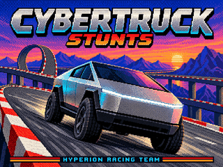

# 08 · Tesla Cybertruck — CYBT FINAL

By **Alain il Professore · Hyperion Racing Team**. For **Stunts 1.1 VGA**.

[Download the original final pack](CYBT_FINAL.zip) · [VGA bitmap](cover.bmp) · [Stunts Mod Garage](https://hyperionracingteamwin.github.io/stunts-data/#tesla-cybertruck)

## The original paintjobs / Les peintures d'origine

Names and order recovered from the original Cybertruck design discussion of 28 October 2026. Names are preserved verbatim; they are custom paintjob nicknames, not manufacturer colour names. The supplied 3D models declare ten paintjobs.

Noms et ordre repris de la discussion de création du Cybertruck du 28 octobre 2026. Les surnoms sont conservés tels quels ; ce ne sont pas des appellations constructeur. Les modèles 3D fournis déclarent dix peintures.

| # | Paintjob | Couleur / colour |
| --- | --- | --- |
| 1 | Robot inox | Inox / stainless steel |
| 2 | Mars red | Rouge / red |
| 3 | bleu cyan cyberpunk | Cyan |
| 4 | greenforest green | Vert forêt / forest green |
| 5 | woke pink | Rose / pink |
| 6 | Trumpery gold | Or / gold |
| 7 | musk brown | Marron / brown |
| 8 | purple eater from mars | Violet / purple |
| 9 | Black is beautiful | Noir / black |
| 10 | White Lies | Blanc / white |

## English

The angular electric pickup joins the garage as project 08. The uploaded final ZIP is published byte for byte; only its repository filename has been normalized to `CYBT_FINAL.zip`.

### Contents

- `CARCYBT.RES` — vehicle resource.
- `STCYBT.3SH` — native 3D models and crash shapes, ten paintjobs.
- `STDACYBT.VSH` — VGA dashboard and steering-wheel resources.
- `STDBCYBT.VSH` — VGA digits and cockpit animation resources.
- `LIREMOI.txt` — original author-supplied notes.

### Installation and removal

Close Stunts. Back up any existing CYBT files. Extract the ZIP and copy CARCYBT.RES, STCYBT.3SH, STDACYBT.VSH and STDBCYBT.VSH into your Stunts 1.1 VGA game folder. Move competing STCYBT.P3S, STDACYBT.PVS and STDBCYBT.PVS outside the game folder if present. To uninstall, remove the four installed files and restore your backups.

The complete ZIP includes all four vehicle files. Its original `LIREMOI.txt` describes an earlier three-file cockpit update and refers to sources and capture reports that are not included in this final archive. The complete-pack instructions above take precedence for this download. No automatic installer is included.

### Publication checks

ZIP CRC checks pass. The four resource-container size fields match the file lengths; resource IDs and offsets are within bounds. `car0`, `car1`, `car2` and the four crash shapes each declare ten paintjobs. Published vehicle bytes match the uploaded ZIP exactly. No new in-game test was performed for this publication; tests described in the original notes are the author's supplied history.

The promotional cover was generated as VGA-style art, then resized and encoded as an indexed **320 × 240, 256-colour** bitmap. `cover.bmp` is an 8-bit BMP; `cover.png` has identical pixels and palette for the web. It is an illustration, not a game screenshot, and is not a game resource.

## Français

Le pickup électrique anguleux devient le projet 08 du garage. Le ZIP final fourni est publié sans modification de ses octets ; seul son nom dans le dépôt devient `CYBT_FINAL.zip`.

### Installation et désinstallation

Fermer Stunts. Sauvegarder les éventuels fichiers CYBT déjà présents. Extraire le ZIP et copier **les quatre fichiers** `CARCYBT.RES`, `STCYBT.3SH`, `STDACYBT.VSH` et `STDBCYBT.VSH` dans le répertoire du jeu Stunts 1.1 VGA. Déplacer hors du jeu les éventuels `STCYBT.P3S`, `STDACYBT.PVS` et `STDBCYBT.PVS` concurrents. Pour désinstaller, retirer les quatre fichiers installés et remettre les sauvegardes.

Le `LIREMOI.txt` original décrit une ancienne mise à jour de cockpit à trois fichiers et cite des sources et rapports absents du ZIP final. Pour ce téléchargement complet, suivre les instructions ci-dessus. Le pack ne contient pas d'installateur automatique.

### Vérifications de publication

CRC du ZIP vérifiés ; tailles déclarées des quatre conteneurs conformes ; identifiants et positions des ressources dans les limites des fichiers ; dix peintures déclarées dans les trois modèles et les quatre formes d'explosion. L'archive publiée est identique au ZIP fourni. Aucun nouvel essai en jeu n'a été réalisé pour cette publication. Les essais mentionnés dans les notes d'origine relèvent de l'historique fourni par l'auteur.

La miniature promotionnelle générée est déclinée en bitmap indexé **320 × 240, 256 couleurs**, en BMP 8 bits et PNG de mêmes pixels et palette. C'est une illustration, pas une capture du jeu ni une ressource à installer.
